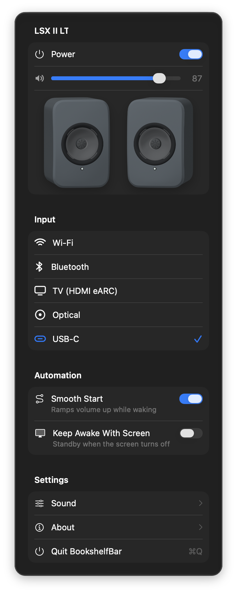

<h1>
  <picture>
    <source media="(prefers-color-scheme: dark)" srcset="docs/logo-dark.svg">
    
  </picture>
  BookshelfBar
</h1>

**macOS menu bar application for KEF speakers**

A native macOS menu bar app for KEF wireless speakers (LSX II LT, LSX II and the rest of the W2 platform), with a fix for common problems, including:

- **Volume surge on wake:** over USB, a sleeping speaker can come back at full volume when audio starts. BookshelfBar wakes it silent and fades up to your level.
- **Standby that won't stick:** an app holding an audio stream open (Spotify, even paused, a browser tab, the iOS Simulator) wakes the speakers straight back up. BookshelfBar lets them actually sleep, and they stay in the macOS Sound menu.
- **Output switching away:** when the speaker drops off USB while waking, macOS can move audio to another device and leave it there. BookshelfBar puts it back.

<p align="center"></p>

- **Control:** power, input, volume and mute, plus desk/wall mode, bass extension, treble, balance, auto-standby, wake source and maximum volume.
- **Smooth Start:** wakes the speakers before audio plays, guards the moment the speaker reconnects over USB, and fades in from silence. The volume can be set while they're asleep; it applies when they fade back on.
- **Keep Awake With Screen:** optional. The speakers stay on while the Mac's screen is on and go to standby when it turns off, if nothing is playing.
- **Volume curve:** shape the slider so everyday listening levels get the most travel.
- **Live:** reflects changes made with the remote, top panel or KEF Connect.
- **Native and light:** SwiftUI with system controls and SF Symbols, no polling, and no network connection at all while the speakers are in standby and the menu is closed.

Requires macOS 26 or later. Not affiliated with KEF.

## Install

**Homebrew:**

```sh
brew install --cask yeutterg/tap/bookshelfbar
```

**Or download** `BookshelfBar-<version>.dmg` from [Releases](https://github.com/yeutterg/bookshelf-bar/releases), open it, and drag BookshelfBar to Applications.

### Opening an app that isn't notarized

BookshelfBar isn't notarized by Apple yet, so the first time you open it macOS says it can't verify the app. To open it anyway:

1. Open BookshelfBar from Applications. When macOS says it can't be opened, click **Done**.
2. Open **System Settings → Privacy & Security** and scroll down to **Security**. Next to "BookshelfBar was blocked to protect your Mac", click **Open Anyway**, then confirm with your password or Touch ID.
3. Click **Open Anyway** once more in the dialog that follows. macOS remembers this, so you only do it once per version.

Or, in Terminal, remove the download quarantine and open it normally:

```sh
xattr -dr com.apple.quarantine /Applications/BookshelfBar.app
```

Only do this for apps you trust. The source is all here, and you can [build it yourself](#build-it-yourself) instead.

## Quick start

1. **Connect the speakers.** Plug the primary speaker into your Mac with USB‑C for USB audio. The Mac and the speakers need to be on the same network.
2. **Open BookshelfBar** and click **Allow** when macOS asks for Local Network access. BookshelfBar uses it to find and control your speakers.
3. **Pick your speakers.** If there's more than one pair on your network, **Identify** wakes a pair briefly so you can tell which is which. You can switch later under **About → Change Speakers…**
4. **Play.** Choose your speakers (e.g. "LSX II LT") in the macOS Sound menu. Smooth Start is on by default: they wake silent and fade up to your volume.
5. **Optional:**
   - Turn on **Keep Awake With Screen** to have the speakers follow your display.
   - Open **Sound** for the volume curve, desk/wall mode, bass extension, treble, balance and the speakers' power settings.
   - If macOS asks whether BookshelfBar may record system audio, that's only so the speaker animation plays while sound is actually coming out. Nothing is recorded. Saying no just keeps the animation still.

## Build it yourself

```sh
swift build                 # library, CLI and app
swift test                  # unit tests
scripts/bundle.sh           # builds build/BookshelfBar.app
open build/BookshelfBar.app
```

On first launch macOS asks for Local Network access, which the app needs to find and control the speakers.

## kefctl

A command-line tool on top of the same library, handy for scripting and debugging:

```sh
swift run kefctl discover
swift run kefctl info
swift run kefctl vol 30
swift run kefctl source usb
swift run kefctl events          # live changes
swift run kefctl usb             # KEF USB audio device state on this Mac
```

## How it works

The speakers expose a local HTTP API on port 80, the same one KEF Connect uses. Since firmware 2.0, writes to settings (DSP, power options) must be signed with the speaker's `HMAC_SHA256_AES256` scheme; `KEFKit` implements it. The USB port is a plain USB Audio Class device, so all control goes over the network.

When a sleeping speaker starts playing over USB, it wakes, drops off the USB bus about 3 s later, and comes back 1–4 s after that as a new audio device. Sometimes it returns at full USB gain before macOS restores the saved volume, and sometimes macOS moves output to another device and doesn't move it back. [docs/RESEARCH.md](docs/RESEARCH.md) has the measurements, the API notes and the design decisions.

## Layout

| Target | What |
|---|---|
| `KEFKit` | HTTP client, request signing, event stream, Bonjour discovery, finish decoding |
| `KEFAudio` | CoreAudio: the KEF USB device, its volume, mute and default-output state |
| `BookshelfBarCore` | Speaker model for the UI and the Smooth Start logic |
| `BookshelfBar` | The SwiftUI menu bar app |
| `kefctl` | CLI |

## Credits

Request signing is adapted from [tkelkermans/KefSleepSync](https://github.com/tkelkermans/KefSleepSync) (0BSD). The API notes draw on [EvotecIT/homeassistant-kef](https://github.com/EvotecIT/homeassistant-kef), [N0ciple/pykefcontrol](https://github.com/N0ciple/pykefcontrol), [hilli/go-kef-w2](https://github.com/hilli/go-kef-w2) and [roberdorfer/kef-lsx-volume](https://github.com/roberdorfer/kef-lsx-volume). KEF, LSX and Uni-Q are trademarks of GP Acoustics. Speaker artwork is rendered from KEF's product models.

## License

MIT

## Releasing

Push a tag like `v0.2.0`. The [release workflow](.github/workflows/release.yml) tests, builds a universal app, signs and notarizes it when the secrets below are set, publishes a GitHub release, and updates the cask in [yeutterg/homebrew-tap](https://github.com/yeutterg/homebrew-tap). Repository secrets:

| Secret | What |
|---|---|
| `DEVELOPER_ID_P12` | Developer ID Application certificate + private key, exported as .p12, base64-encoded |
| `DEVELOPER_ID_P12_PASSWORD` | Password for that .p12 |
| `NOTARY_KEY_P8` | App Store Connect API key (.p8 contents) for `notarytool` |
| `NOTARY_KEY_ID`, `NOTARY_ISSUER_ID` | That key's ID and issuer ID |
| `HOMEBREW_TAP_TOKEN` | Fine-grained token with write access to `yeutterg/homebrew-tap` |

Without the signing secrets the workflow still builds a DMG, but it isn't notarized. Locally: `VERSION=0.2.0 scripts/release.sh` (set `SIGN_IDENTITY` and the `NOTARY_*` variables to sign and notarize).

